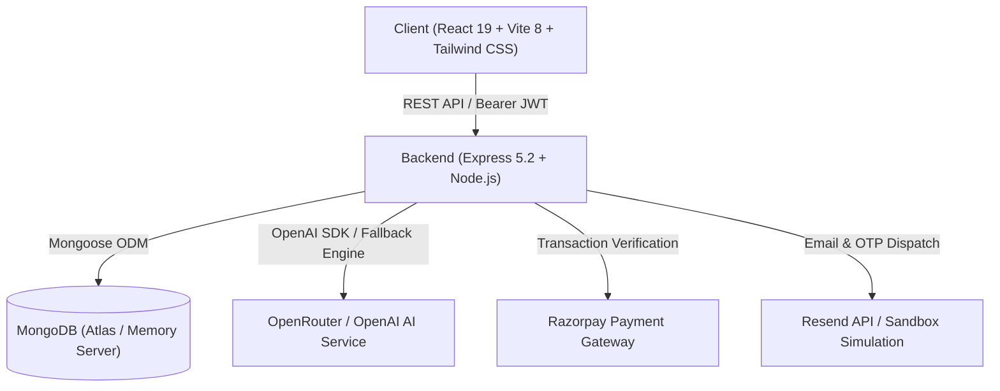

# MockMate Pro 🚀

> **AI-Powered Technical Assessment & Live Interview Simulation Platform**  
> Built by **Aditya Singh** ([sadityasingh7990@gmail.com](mailto:sadityasingh7990@gmail.com))

[](https://nodejs.org/)
[](https://react.dev/)
[](https://vitejs.dev/)
[](https://tailwindcss.com/)
[](https://opensource.org/licenses/ISC)

---

## 🌟 Overview

**MockMate Pro** is an end-to-end technical interview preparation and assessment engine designed for engineers targeting top-tier product and enterprise software teams (Google, Amazon, Microsoft, Meta, and more). It delivers:

1. **Adaptive MCQ Practice Drills**: Role-tailored question sets across 10+ engineering tracks (Frontend, Backend, Full Stack, DevOps, Data Science, Machine Learning, etc.) with real-time countdowns, proctoring violation alerts, and deep diagnostic explanations.
2. **Interactive Live Technical Interviews**: Conversational AI technical interviews with browser Speech-to-Text (STT) and Text-to-Speech (TTS), real-time evaluation reactions, dynamic follow-ups, and full quantitative rubric scorecards.
3. **Company-Targeted Preparation Tracks**: Specialized interview tracks tailored to specific engineering bars, levels (Entry, Mid, Senior), and question volumes for top companies.
4. **Subscription & Payment System**: Integrated Razorpay workflow supporting monthly and yearly access tiers with automated transaction tracking and cancellation handling.
5. **Zero-Config Resilient Architecture**: Auto-discovering in-memory database fallback for instant local execution, along with offline/simulated OTP email fallback so development and testing never stall.

---

## 🏗️ Architecture & Tech Stack



- **Frontend**: React 19, Vite 8, Tailwind CSS, React Router v7, React Hot Toast, Axios.
- **Backend**: Node.js, Express 5.2, Mongoose 9.3, JWT, bcryptjs, MongoDB Memory Server.
- **AI & Evaluation**: OpenRouter / OpenAI SDK with role-specialized curated fallback banks.
- **Audio / Voice**: Web Speech API (`SpeechRecognition` & `speechSynthesis`).

---

## 🚀 Quick Start Guide

### 1. Prerequisites
- Node.js (v18 or newer recommended)
- npm (v9 or newer)

### 2. Installation

Clone the repository and install dependencies for both the backend and client:

```bash
# Clone the repository
git clone https://github.com/adisingh0824/MockMate-Pro.git
cd MockMate-Pro

# Install backend dependencies
cd backend
npm install

# Install client dependencies
cd ../client
npm install
```

### 3. Environment Variables Configuration

#### Backend Configuration (`backend/.env`):
```env
PORT=5800
NODE_ENV=development
MONGO_URI=mongodb://localhost:27017/mockmate_pro
JWT_SECRET=dev_mockmate_jwt_secret_key_aditya_2026
JWT_EXPIRES_IN=7d
CORS_ORIGIN=*
OTP_LENGTH=6
OTP_EXPIRY_SECONDS=600
OTP_MAX_ATTEMPTS=5
BCRYPT_SALT_ROUNDS=10

# Email (Resend) - Optional in dev (falls back to terminal OTP output)
RESEND_API_KEY=
RESEND_SENDER_EMAIL=sadityasingh7990@gmail.com
RESEND_SENDER_NAME=MockMate Pro
EMAIL_FROM=Aditya Singh <sadityasingh7990@gmail.com>

# Razorpay - Optional for dev testing
RAZORPAY_KEY_ID=
RAZORPAY_KEY_SECRET=

# AI Provider - Optional (falls back to built-in curated question banks)
OPENROUTER_API_KEY=
OPENROUTER_MODEL=gpt-4o-mini
```

#### Client Configuration (`client/.env`):
```env
VITE_API_BASE_URL=http://localhost:5800/api
```

### 4. Running the Application

In terminal 1 (Backend):
```bash
cd backend
npm start
# Runs on http://localhost:5800
```

In terminal 2 (Client):
```bash
cd client
npm run dev
# Vite dev server opens on http://localhost:3000
```

---

## 🧪 Testing & Verification

MockMate Pro comes with an automated end-to-end verification suite testing all API endpoints, authentication flows, session generation, evaluation rubric generation, and fallback engines:

```bash
cd backend
npm test
```

To run frontend linting and production build:
```bash
cd client
npm run lint
npm run build
```

---

## 🔑 Default Demo Credentials

For quick local evaluation, the database auto-seeds a pre-configured demo account on initial startup:
- **Email**: `testuser@gmail.com`
- **Password**: `testpassword@1234`

---

## 📡 Core API Endpoints

| Category | Method | Endpoint | Description |
| :--- | :--- | :--- | :--- |
| **Auth** | `POST` | `/api/auth/register` | Register new user & dispatch OTP |
| **Auth** | `POST` | `/api/auth/verify-otp` | Verify OTP code & activate account |
| **Auth** | `POST` | `/api/auth/login` | Authenticate & retrieve JWT token |
| **Auth** | `GET` | `/api/auth/me` | Fetch active profile |
| **Sessions** | `GET` | `/api/sessions/roles` | List available engineering roles |
| **Sessions** | `GET` | `/api/sessions/config` | Retrieve session difficulties & volumes |
| **Sessions** | `POST` | `/api/sessions/start` | Start practice session & generate questions |
| **Sessions** | `POST` | `/api/sessions/:id/submit` | Submit answers & receive evaluation |
| **Interview** | `POST` | `/api/interview/start` | Launch live AI interview round |
| **Interview** | `POST` | `/api/interview/:id/respond` | Submit verbal/typed answer & receive follow-up |
| **Interview** | `POST` | `/api/interview/:id/finish` | Conclude interview & receive full rubric score |
| **Companies** | `GET` | `/api/companies` | List company tracks and roles |
| **Payments** | `POST` | `/api/payments/create-order` | Initiate Razorpay order |
| **Payments** | `POST` | `/api/payments/verify` | Verify signature and activate premium |

---

## 👤 Author

Developed by **Aditya Singh**  
- **Email**: [sadityasingh7990@gmail.com](mailto:sadityasingh7990@gmail.com)  
- **GitHub**: [@adisingh0824](https://github.com/adisingh0824)
