# MockMate Pro 
https://mockmateproo.netlify.app

MockMate Pro is an AI-powered interview preparation platform built to help candidates practice smarter, track progress, and prepare for real hiring rounds with confidence. It combines role-based practice tests, live AI interview simulation, company preparation content, progress history, profile management, and premium access flows in one full-stack application.

## Why This Project Stands Out

- Built as a complete product, not just a demo screen.
- Covers the full mock interview journey from onboarding to feedback and history.
- Includes both practice-based learning and live interview simulation.
- Supports premium plans and Razorpay test-mode payment flow.
- Designed to show product thinking, execution quality, and real-world usefulness.

## Product Story

MockMate Pro solves a simple but important problem: many candidates know what to study, but they do not have a structured way to practice interviews, get feedback, and improve over time. This platform gives them a guided experience:

1. Select a role or interview path.
2. Practice with structured questions and timed sessions.
3. Attempt a live AI interview experience.
4. Review performance, feedback, and history.
5. Upgrade to premium for advanced features.

## Core Features

- Authentication flow with login, registration, OTP verification, and password recovery.
- Role selection and practice test selection for different preparation paths.
- AI-powered interview setup and live interview experience.
- Company-specific preparation section.
- Session feedback and interview history tracking.
- User profile management.
- Premium plan and Razorpay test payment integration.

## User Journey

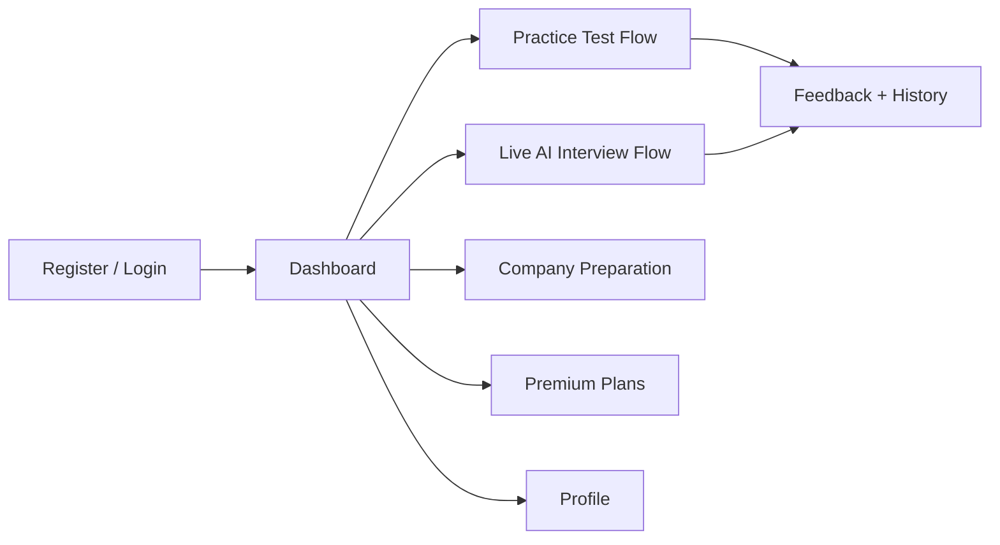

## Screenshots

### 1. Dashboard

The dashboard acts as the main control center for the candidate. It gives quick access to the available preparation paths, recent activity, and navigation to the rest of the app.

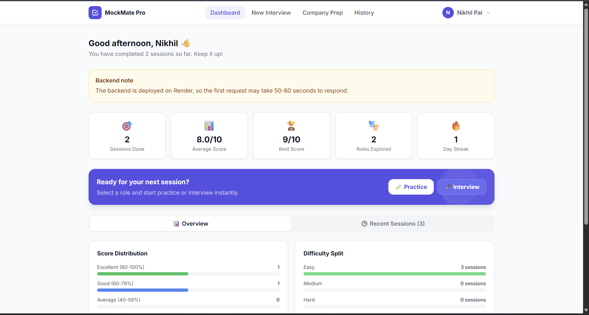

### 2. Practice Test Role Selection

This screen helps the user choose the right preparation track before starting a test.

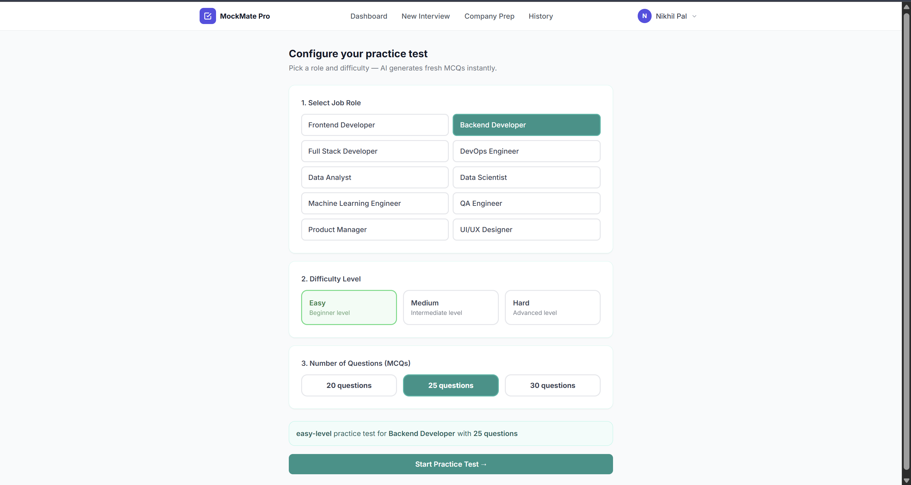

### 3. Practice Test

The practice test flow simulates a focused interview-prep session with structured questions.

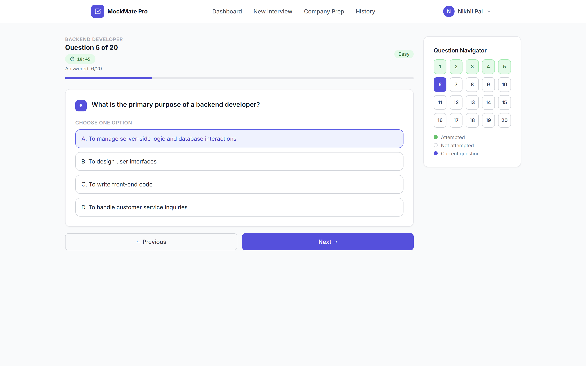

### 4. Practice Test Result

After completion, the user receives a result view that can be used to measure performance and improvement.

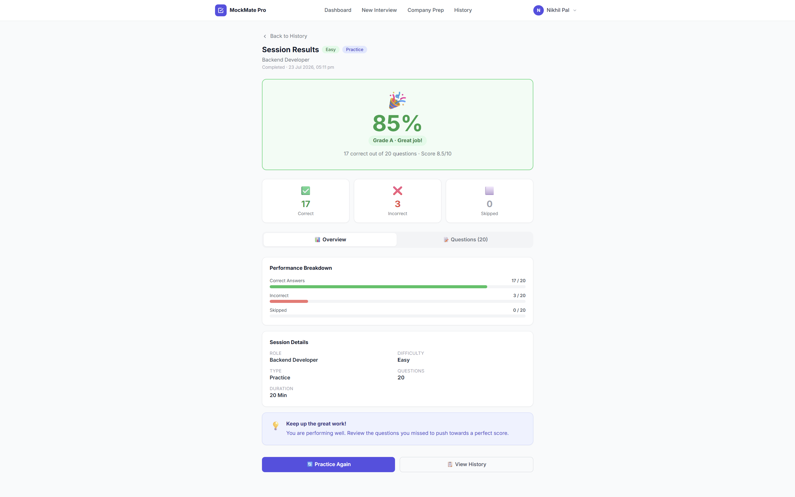

### 5. Interview Selection

This screen sets up the live interview path so the user can choose the scenario they want to face.

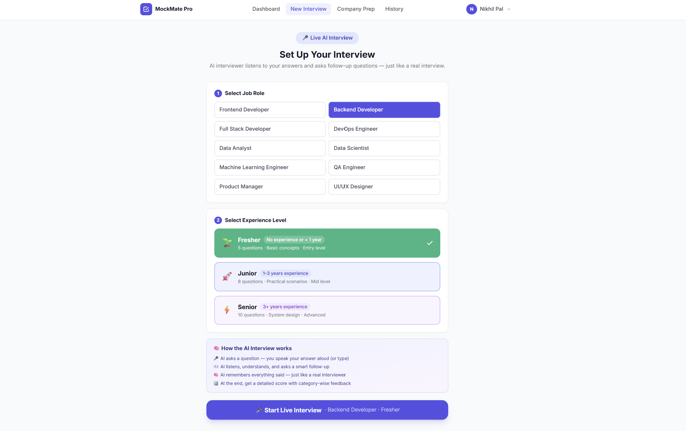

### 6. Interview Screen

This view shows the active interview experience where the AI-led session begins.

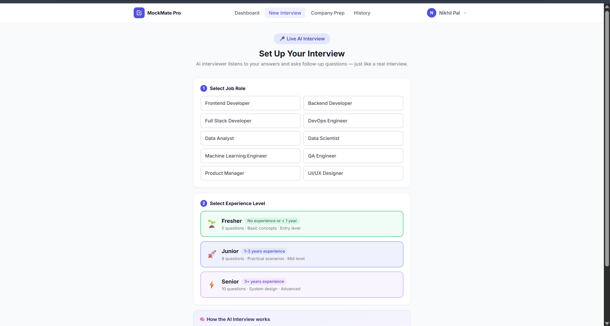

### 7. Live Interview

The live interview module creates a more realistic interview environment and is one of the strongest product highlights.

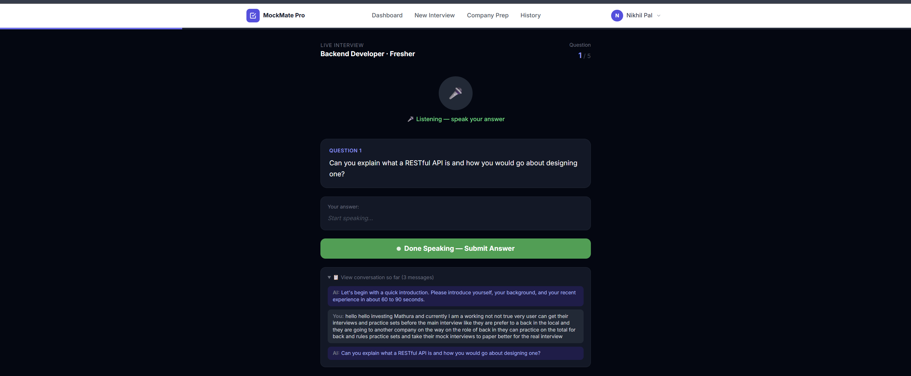

### 8. Company Preparation

This section helps users prepare specifically for target companies and role expectations.

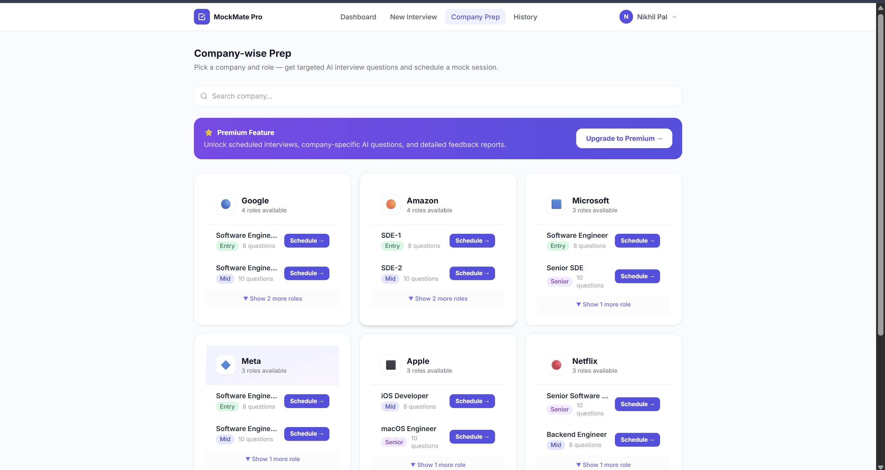

### 9. History

The history page helps the user revisit past attempts and track progress over time.

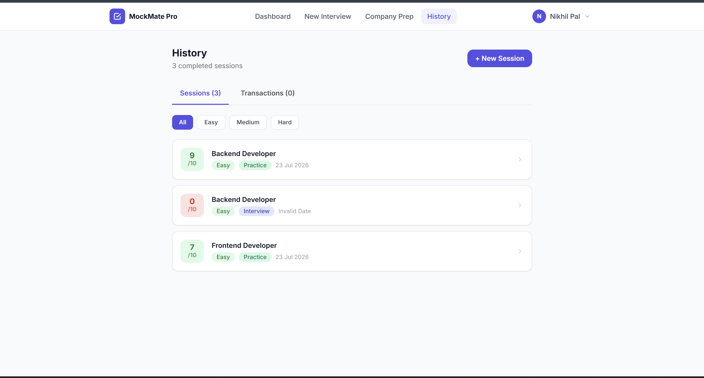

### 10. Profile

The profile screen keeps personal details and account information organized.

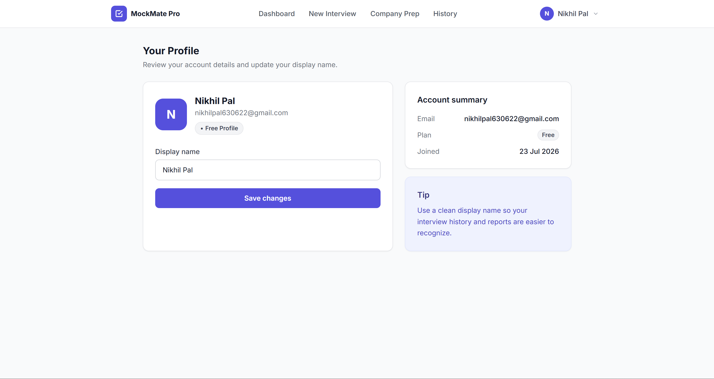

### 11. Premium Plans

Premium upgrades are presented clearly to support monetization and advanced feature access.

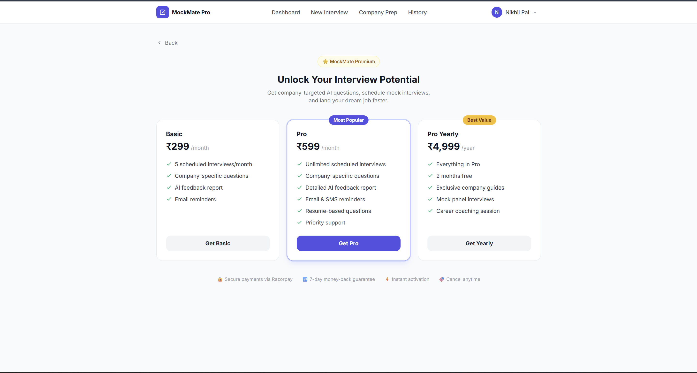

### 12. Razorpay Test Mode

Payment flow is demonstrated in test mode using Razorpay.

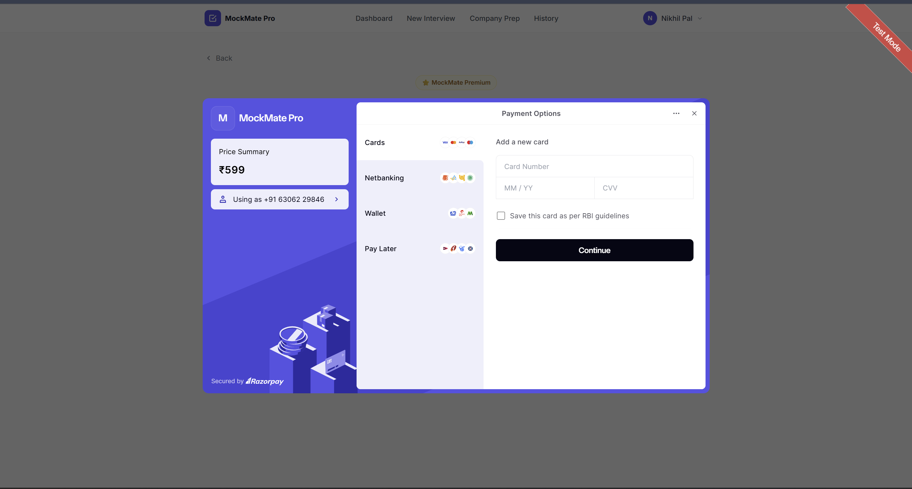

## Tech Stack

- Frontend: React, Vite, React Router, Axios, Tailwind CSS.
- Backend: Node.js, Express, MongoDB, Mongoose.
- Auth: JWT, OTP-based verification, password reset support.
- Payments: Razorpay.
- AI / Integrations: OpenRouter, OpenAI, Gemini API, Google Cloud Text-to-Speech, Nodemailer, Resend.

## Project Structure

```text
backend/
client/
README.md
```

## How to Run Locally

### 1. Clone the repository

```bash
git clone <your-repo-url>
cd MockMate-Pro
```

### 2. Install backend dependencies

```bash
cd backend
npm install
```

### 3. Install frontend dependencies

```bash
cd ../client
npm install
```

### 4. Configure environment variables

Create or update the backend `.env` file with the required values such as `MONGO_URI`, `JWT_SECRET`, email credentials, AI keys, and Razorpay keys.

### 5. Start the backend

```bash
cd backend
npm run dev
```

### 6. Start the frontend

Open a second terminal and run:

```bash
cd client
npm run dev
```

### 7. Open the app

Use the local Vite URL shown in the terminal, usually:

```bash
http://localhost:5173
```

## Environment Notes

- The backend reads its configuration from `backend/.env`.
- MongoDB Atlas requires a valid username, password, and cluster access configuration.
- Payment and AI features may require valid test keys or API keys depending on the flow being demonstrated.

## HR-Focused Summary

MockMate Pro is a strong portfolio project because it demonstrates full-stack engineering, product thinking, user flow design, API integration, authentication, payments, and AI-driven experiences in one place. It is not only functional, but also presentation-ready for interviews, demos, and resume evaluation.

## Author

- **Aditya Singh** - [sadityasingh7990@gmail.com](mailto:sadityasingh7990@gmail.com)

## Notes

- Screenshot paths are linked from the `backend/SS` folder.
- If you want, I can also turn this into a more branded README with badges, a feature table, and a deployment section for Render or Vercel.
